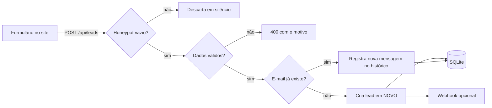

<div align="center">

# 📇 LeadConnector API

### Do formulário ao fechamento: cada contato no lugar certo do funil.

**Um mini CRM para capturar leads de landing pages e sites institucionais. Você coloca no ar em minutos e usa em qualquer front-end.**


[Rodar](#-passo-1--rodar-local) · [Testar](#-passo-2--teste-em-60-segundos) · [Painel](#-painel-visual) · [Hospedar](#%EF%B8%8F-passo-3--colocar-no-ar) · [Conectar ao site](#-passo-4--conectar-ao-seu-formulário) · [API](#-referência-da-api)

</div>

---

## 🎯 O que é

Um formulário de contato comum **joga o lead num e-mail** e ele se perde. O **LeadConnector** guarda cada contato, organiza num **funil de vendas** e deixa você acompanhar quem já foi atendido.

```
   📝 Formulário do site
          │  POST /api/leads
          ▼
  ┌──────────────┐     ┌────────────────┐     ┌────────────────┐
  │   🆕 NOVO    │ ──▶ │ 📞 EM CONTATO  │ ──▶ │ ✅ CONVERTIDO  │
  └──────────────┘     └────────────────┘     └────────────────┘
          │
          └──▶ 🔔 Aviso opcional no Slack / Discord / Zapier
```

### ✨ Recursos

| | Recurso | Detalhe |
|---|---|---|
| 📥 | **Captura** | Nome, e-mail, telefone, mensagem e origem (de qual site veio) |
| 🧭 | **Funil** | `novo` → `em_contato` → `convertido`, com histórico de cada mudança |
| 🔐 | **Rotas protegidas** | Listagem, edição, exclusão e exportação só com `API_KEY` |
| 🔎 | **Busca e paginação** | Filtre por etapa ou procure por nome, e-mail, telefone |
| 📊 | **Métricas** | Total, taxa de conversão, leads por dia e principais origens |
| 🧲 | **Sem duplicados** | O mesmo e-mail vira "nova mensagem" no histórico do lead existente |
| 🍯 | **Anti-spam** | Honeypot invisível + rate limit por IP |
| 🔔 | **Webhook** | Receba aviso de cada novo lead no Slack, Discord, Zapier ou Make |
| ⬇️ | **Exportação CSV** | Abre direto no Excel/Sheets (com proteção contra injeção de fórmulas) |
| 🖥️ | **Painel pronto** | Kanban em `/admin.html` e formulário demo em `/` |

---

## 🚀 Passo 1 — Rodar local

Pré-requisito: [Node.js 18+](https://nodejs.org) (`node -v` para conferir).

```bash
git clone https://github.com/SEU-USUARIO/leadconnector-api.git
cd leadconnector-api
npm install
cp .env.example .env     # Windows (cmd): copy .env.example .env
```

Abra o `.env` e **troque a `API_KEY`** por algo forte. Para gerar uma:

```bash
openssl rand -hex 24
```

Depois:

```bash
npm start
```

| Endereço | O que é |
|---|---|
| http://localhost:3000 | Formulário de demonstração |
| http://localhost:3000/admin.html | Painel (peça a `API_KEY` que você definiu) |

<details>
<summary>🐳 Docker</summary>

```bash
docker build -t leadconnector .
docker run -p 3000:3000 -v leads-data:/data -e API_KEY=sua-chave leadconnector
```
</details>

<details>
<summary>🧪 Testes automatizados</summary>

```bash
npm test
```
</details>

---

## 🧪 Passo 2 — Teste em 60 segundos

**① Envie um lead (rota pública)**
```bash
curl -X POST http://localhost:3000/api/leads \
  -H "Content-Type: application/json" \
  -d '{"name":"Maria Silva","email":"maria@empresa.com","phone":"(11) 98888-7777","message":"Quero um orçamento","source":"landing-black-friday"}'
```
```json
{ "ok": true, "message": "Recebemos seu contato!" }
```

**② Liste (rota protegida)**
```bash
curl http://localhost:3000/api/leads -H "x-api-key: SUA_CHAVE"
```

**③ Mova no funil**
```bash
curl -X PATCH http://localhost:3000/api/leads/1 \
  -H "x-api-key: SUA_CHAVE" -H "Content-Type: application/json" \
  -d '{"stage":"em_contato","notes":"Liguei, retorno amanhã"}'
```

**④ Veja os números**
```bash
curl http://localhost:3000/api/leads/stats -H "x-api-key: SUA_CHAVE"
```
```json
{ "total": 1, "byStage": { "novo": 0, "em_contato": 1, "convertido": 0 }, "conversionRate": 0, "leadsByDay": [...], "topSources": [...] }
```

---

## 🖥️ Painel visual

Acesse `/admin.html`, informe a `API_KEY` e você terá:

- 3 colunas do funil, com botões para mover o lead de etapa
- Busca em tempo real
- Contador de leads e taxa de conversão
- Exportação em CSV (separado por `;`, abre certinho no Excel em português)

> A chave fica só na aba do navegador (sessionStorage) e some ao fechar a aba.

---

## ☁️ Passo 3 — Colocar no ar

Para **testes pequenos**, estas são as opções mais simples. *(Planos gratuitos mudam com frequência: confira os limites atuais no site de cada serviço.)*

| Serviço | Dificuldade | Dados persistem? | Quando usar |
|---|---|---|---|
| **Render** ⭐ | 🟢 Fácil | ⚠️ Não no plano grátis | Demo e portfólio |
| **Railway** | 🟢 Fácil | ✅ Com Volume | Testes com leads que precisam ficar |
| **Fly.io** | 🟡 Média | ✅ Com Volume | Mais controle, usa Docker |
| **Koyeb** | 🟢 Fácil | ⚠️ Verifique o plano | Alternativa ao Render |
| **VPS** (Oracle Free, Hetzner...) | 🔴 Trabalhoso | ✅ Sim | Uso real, de longo prazo |
| **Seu PC + Cloudflare Tunnel** | 🟢 Fácil | ✅ Sim | Mostrar para alguém agora |

> ⚠️ **Leads são dados valiosos.** Em hospedagem gratuita **sem disco persistente**, o SQLite é apagado quando o serviço reinicia. Para demo, tudo bem. **Para leads reais, use um volume (Railway, Fly.io, VPS) e aponte `DB_PATH` para ele**, e faça backup baixando o CSV de tempos em tempos. Planos grátis também "dormem" sem uso, então o primeiro envio depois pode demorar alguns segundos.

### 🥇 Render (o mais simples)

1. Suba o projeto no **seu GitHub**.
2. Em [render.com](https://render.com): **New → Blueprint** → escolha o repositório. Ele lê o `render.yaml` e configura build, start, health check e gera a `API_KEY` sozinho.
3. Quando o deploy terminar, abra **Environment**, copie o valor da `API_KEY` (você vai precisar dela no painel) e, em `CORS_ORIGIN`, troque `*` pelo domínio do seu site.
4. Teste `https://sua-url.onrender.com/health` → `{"status":"ok"}`.

### 🚆 Railway (com volume)

1. [railway.app](https://railway.app) → **New Project → Deploy from GitHub repo**.
2. **Variables:** `API_KEY` e `CORS_ORIGIN`.
3. **Settings → Networking → Generate Domain**.
4. **Volumes:** crie um volume em `/data` e adicione `DB_PATH=/data/leads.db`.

### 🪁 Fly.io

```bash
fly launch --no-deploy
fly volumes create data --size 1
# no fly.toml adicione:  [mounts]  source = "data"  destination = "/data"
fly secrets set API_KEY=$(openssl rand -hex 24)
fly deploy
```

### 🏠 Teste relâmpago com seu PC

```bash
npm start
cloudflared tunnel --url http://localhost:3000   # gera uma URL pública temporária
```

### 🔧 Variáveis de ambiente

| Variável | Função | Padrão |
|---|---|---|
| `API_KEY` | Chave das rotas protegidas. **Sem ela, tudo protegido fica desligado.** | vazio |
| `CORS_ORIGIN` | Sites autorizados a enviar o formulário (vírgula) ou `*` | `*` |
| `WEBHOOK_URL` | Aviso de novo lead (Slack, Discord, Zapier, Make) | vazio |
| `RATE_LIMIT` | Envios por minuto por IP | `10` |
| `DB_PATH` | Caminho do banco SQLite | `./data/leads.db` |
| `PORT` | Porta (a hospedagem define sozinha) | `3000` |

### ✅ Checklist antes de divulgar

- [ ] `API_KEY` forte e guardada só com você
- [ ] `CORS_ORIGIN` com o domínio real do site
- [ ] Volume persistente configurado (se os leads forem reais)
- [ ] Texto de consentimento/privacidade no formulário
- [ ] Webhook configurado para você ser avisado

---

## 🧩 Passo 4 — Conectar ao seu formulário

Com a API no ar (ex: `https://seu-app.onrender.com`):

> 🔑 Coloque o domínio do seu site em `CORS_ORIGIN` (ex: `https://meusite.com.br`, sem barra no final), senão o navegador bloqueia o envio.
> 🚫 **Nunca coloque a `API_KEY` no front-end.** O envio do formulário é público e **não precisa de chave**. A chave é só para você consultar os leads.

### HTML + JavaScript puro

```html
<form id="contato">
  <input name="name" placeholder="Nome" required>
  <input name="email" type="email" placeholder="E-mail" required>
  <input name="phone" placeholder="WhatsApp">
  <textarea name="message" placeholder="Mensagem"></textarea>

  <!-- Honeypot anti-robô: deixe invisível, não remova -->
  <input name="website" style="position:absolute;left:-9999px" tabindex="-1" autocomplete="off">

  <label><input type="checkbox" name="consent"> Concordo em ser contatado(a)</label>
  <button>Enviar</button>
  <p id="status"></p>
</form>

<script>
  const API = 'https://seu-app.onrender.com';
  const form = document.getElementById('contato');

  form.addEventListener('submit', async (e) => {
    e.preventDefault();
    const dados = Object.fromEntries(new FormData(form));
    dados.consent = form.consent.checked;
    dados.source = 'landing-principal'; // opcional: identifica a campanha

    const r = await fetch(`${API}/api/leads`, {
      method: 'POST',
      headers: { 'Content-Type': 'application/json' },
      body: JSON.stringify(dados),
    });
    const res = await r.json();
    document.getElementById('status').textContent = r.ok ? '✅ ' + res.message : '❌ ' + res.error;
    if (r.ok) form.reset();
  });
</script>
```

### React

```jsx
import { useState } from 'react';
const API = import.meta.env.VITE_LEADS_API;

export default function ContactForm() {
  const [status, setStatus] = useState('');

  async function onSubmit(e) {
    e.preventDefault();
    const f = e.target;
    const r = await fetch(`${API}/api/leads`, {
      method: 'POST',
      headers: { 'Content-Type': 'application/json' },
      body: JSON.stringify({
        name: f.name.value, email: f.email.value, phone: f.phone.value,
        message: f.message.value, website: f.website.value, consent: f.consent.checked,
      }),
    });
    const data = await r.json();
    setStatus(r.ok ? data.message : data.error);
    if (r.ok) f.reset();
  }

  return (
    <form onSubmit={onSubmit}>
      <input name="name" placeholder="Nome" required />
      <input name="email" type="email" placeholder="E-mail" required />
      <input name="phone" placeholder="WhatsApp" />
      <textarea name="message" placeholder="Mensagem" />
      <input name="website" style={{ position: 'absolute', left: -9999 }} tabIndex={-1} autoComplete="off" />
      <label><input type="checkbox" name="consent" /> Concordo em ser contatado(a)</label>
      <button>Enviar</button>
      <p>{status}</p>
    </form>
  );
}
```

### 🔔 Receber avisos no Slack ou Discord

1. Crie um *Incoming Webhook* (Slack) ou um *Webhook de canal* (Discord → Configurações do canal → Integrações).
2. Cole a URL em `WEBHOOK_URL`.
3. Pronto: cada lead novo gera uma mensagem no canal. Também funciona com **Zapier** e **Make** para mandar para Google Sheets, e-mail, WhatsApp etc.

### Consultando os leads do seu próprio backend

```js
// Servidor (Node, PHP, Python...). NUNCA no navegador do visitante.
const r = await fetch(`${process.env.LEADS_API}/api/leads?stage=novo&limit=50`, {
  headers: { 'x-api-key': process.env.LEADS_API_KEY },
});
const { data, total } = await r.json();
```

---

## 📡 Referência da API

| Método | Rota | Acesso | Descrição |
|---|---|---|---|
| `POST` | `/api/leads` | 🌐 público | Recebe um lead do formulário |
| `GET` | `/api/leads` | 🔐 chave | Lista (filtros `stage`, `q`, `page`, `limit`) |
| `GET` | `/api/leads/:id` | 🔐 chave | Detalhe + histórico de eventos |
| `PATCH` | `/api/leads/:id` | 🔐 chave | Altera `stage` e/ou `notes` |
| `DELETE` | `/api/leads/:id` | 🔐 chave | Apaga o lead (direito de exclusão, LGPD) |
| `GET` | `/api/leads/stats` | 🔐 chave | Métricas do funil |
| `GET` | `/api/leads/export.csv` | 🔐 chave | Exporta em CSV (aceita `stage` e `q`) |
| `GET` | `/health` | 🌐 público | Verifica se está no ar |

A chave vai no header `x-api-key`.

**Campos do `POST /api/leads`**

| Campo | Obrigatório | Regra |
|---|---|---|
| `name` | ✅ | 2 a 100 caracteres |
| `email` | ✅ | formato válido (único por lead) |
| `phone` | ❌ | 8 a 15 dígitos |
| `message` | ❌ | até 2000 caracteres |
| `source` | ❌ | identifica a campanha (se omitido, usa o domínio de origem) |
| `consent` | ❌ | `true` se a pessoa marcou o aceite |
| `website` | ❌ | **honeypot**: deve ficar vazio |

**Respostas:** `201` criado · `200` e-mail já existia (mensagem registrada) · `400` dado inválido · `401` chave errada · `403` rotas protegidas desligadas · `404` não encontrado · `429` muitos envios.

---

## ⚙️ Como funciona por dentro



```
leadconnector-api/
├── src/
│   ├── server.js      # rotas, validação, funil, métricas, CSV, webhook
│   └── db.js          # SQLite e tabelas
├── public/
│   ├── index.html     # formulário de demonstração
│   └── admin.html     # painel kanban
├── test/api.test.js
├── Dockerfile · render.yaml · .env.example
```

**Decisões de projeto**

- **Honeypot responde "sucesso":** o robô acha que deu certo e não tenta de novo.
- **E-mail único:** evita lead duplicado, e a nova mensagem não se perde, vai para o histórico.
- **Comparação de chave em tempo constante** (`timingSafeEqual`) contra ataques de temporização.
- **CSV sanitizado:** células começando com `=`, `+`, `-` ou `@` são neutralizadas.
- **Etapas do funil em uma constante** (`STAGES` em `server.js`): para incluir "Perdido" ou "Proposta enviada", é só adicionar ali.

**Banco**

| `leads` | `lead_events` |
|---|---|
| id, name, email (único), phone, message, source, stage, notes, consent, created_at, updated_at | id, lead_id, type (`criado`, `nova_mensagem`, `etapa`), detail, created_at |

---

## 🔒 LGPD em poucas linhas

> Isto **não é aconselhamento jurídico**, apenas boas práticas.

- Informe no formulário **para que** os dados serão usados e inclua link para a política de privacidade.
- O campo `consent` registra se a pessoa marcou o aceite.
- Use `DELETE /api/leads/:id` para atender pedidos de exclusão.
- Colete só o necessário: o telefone, por exemplo, é opcional.

## ❓ Problemas comuns

<details><summary>Erro de CORS no navegador</summary>
Coloque o domínio exato do site (com <code>https://</code>, sem barra no final) em <code>CORS_ORIGIN</code>. Se for mais de um, separe por vírgula.
</details>

<details><summary>Retorna 403 "Rotas protegidas desativadas"</summary>
A <code>API_KEY</code> não está definida no ambiente. Configure-a e reinicie.
</details>

<details><summary>Os leads sumiram</summary>
Provavelmente a hospedagem não tem disco persistente. Veja o aviso do Passo 3.
</details>

<details><summary>Recebi 429 ao testar várias vezes</summary>
É o rate limit (padrão: 10 envios/min por IP). Aumente com <code>RATE_LIMIT</code> durante os testes.
</details>

<details><summary>O lead não aparece, mas a API respondeu sucesso</summary>
Verifique se o campo honeypot (<code>website</code>) não está sendo preenchido por um gerenciador de senhas/autofill. Deixe <code>autocomplete="off"</code>.
</details>

## 🗺️ Próximos passos

- [ ] Etapa "Perdido" e motivo da perda
- [ ] Responsável pelo lead (multiusuário)
- [ ] Envio de e-mail automático de confirmação
- [ ] Troca do SQLite por PostgreSQL
- [ ] Campos personalizados por formulário

## 📄 Licença

MIT. Use, modifique e compartilhe à vontade.

<div align="center">⭐ Se foi útil, deixe uma estrela no repositório!</div>
